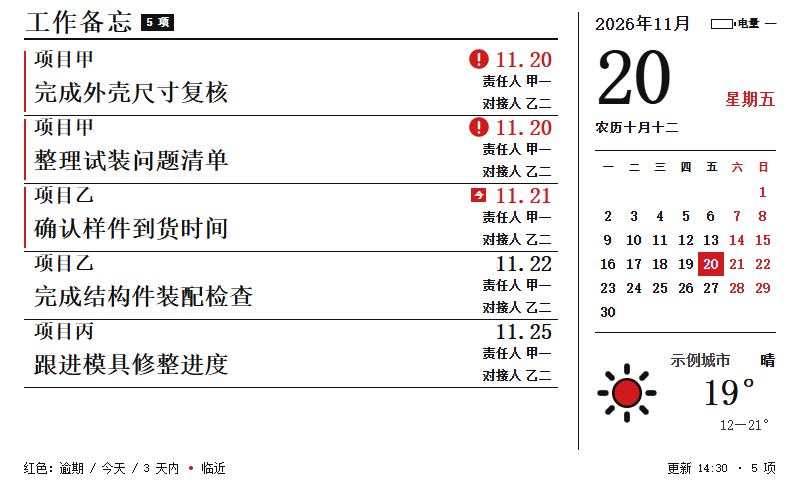
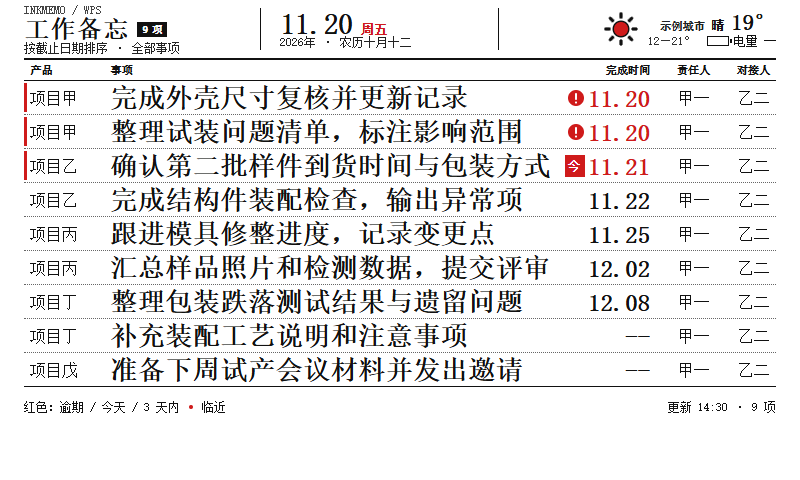
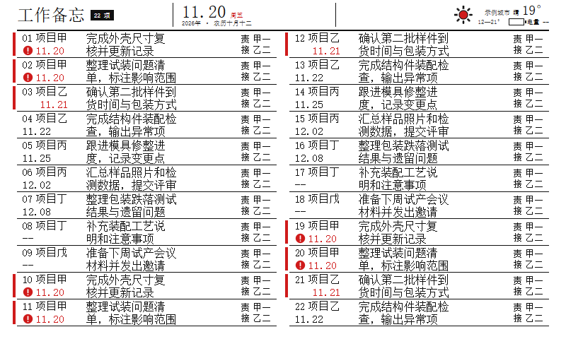

# 墨笺 InkMemo

> 把 WPS 云端表格变成桌上的一块黑红白墨水屏看板。不开电脑、不开表格，抬眼就能看到今天要处理的事。

Windows 后台常驻程序：定时读取指定的 WPS 共享表格，把「产品 / 事项 / 完成时间 / 责任人 / 对接人」五列排成 800×480 的黑白红画面，通过本机蓝牙直接推送到 nRF_EPD 墨水屏。不需要云服务器，不需要额外网关，也不需要一直开着 WPS。

Windows 11 · Python 3.12 · 800×480 三色墨水屏 · GPL-3.0

## 为什么做这个

生产跟进、打样、试产这类事项通常活在 WPS 共享表格里：多人协作方便，但「今天该看哪几条」得打开电脑、找到链接、滚动表格。挂在工位上的墨水屏没有背光、断电不丢画面、几乎不耗电，正适合当一块常亮的待办看板。

InkMemo 只做一件事：**把那张表里最该被看到的部分，稳定地放到屏幕上。**

## 画面

| 宽松版（1–5 项） | 标准版（6–12 项） | 紧凑版（13–30 项） |
| --- | --- | --- |
|  |  |  |

截图为运行时真实渲染结果，事项与姓名均为虚构示例。三套版式均经真实设备目视验收，切换档位由事项条数自动决定。

## 核心特性

- **云端直读**：后台无头读取 WPS 共享表格，WPS 桌面客户端关闭时仍可取数；不依赖本地同步目录或人工导出。
- **五字段完整展示**：产品、事项、完成时间、责任人、对接人；不新增状态列，不猜完成状态。
- **排序可预期**：逾期 → 今天 → 未来由近到远 → 日期待定；同一日期保持源表顺序。
- **三档自适应版式**：按条数选档，用完整文本实测；放不下就升档，绝不截断、分页或隐藏事项。
- **黑白红三色**：800×480 双位平面，黑红各 48,000 字节；逾期、今天、临近用红色区分。
- **无常驻窗口**：托盘静默运行，单实例，登录自启，支持随时暂停/恢复。
- **可手动拉起**：打包版首次运行在桌面创建快捷方式，自启失效时可一键启动。
- **抬头信息**：公历、星期、农历、城市天气、看板电压/电量；天气或电压读取失败不影响事项展示。
- **故障分治**：云端读取失败、蓝牙失败、刷新结果不确定分别建模，不会把「读取失败」当成「暂无待办」。

## 工作流程

```text
WPS 共享表格（云端）
        │  无头 Edge 直连读取 A:E
        ▼
  五字段解析 · 合并单元格展开 · 日期归一 · 排序
        │
        ▼
  版式选择（宽松 / 标准 / 紧凑）+ 字体测量
        │  800×480 黑红双位平面
        ▼
  BLE 0x31 顺序分块 · CRC · 逐块 ACK · 双层依次传输
        │
        ▼
  nRF_EPD 墨水屏刷新
```

默认每 1800 秒检查一次，启动后立即检查一次。内容哈希未变化时不连接看板；暂停期间不取数、不连接、不传图。

## 版式与容量

| 条数 | 版式 | 说明 |
| --- | --- | --- |
| 1–5 | 宽松 | 项目名在事项上方，右侧月历、天气、电量 |
| 6–12 | 标准 | 五列台账；11–12 项自动使用容量子样式 |
| 13–30 | 紧凑 | 双栏三列，项目/日期、事项、责任人/对接人 |
| >30 或实测溢出 | `LAYOUT_OVERFLOW` | 不发送删减版，保留上一张完整画面 |

数量只决定**起始档位**。渲染后会按完整文本实测，放不下就按更密的档位逐级重试；所有档位都放不下才报溢出。

## 快速开始

### 环境要求

- Windows 11 x64（依赖 DPAPI、WinRT 定位、计划任务与系统宋体）
- Python 3.12
- 一块 800×480 黑白红 UC8179 / nRF_EPD 兼容看板
- 电脑具备蓝牙，且看板处于可广播状态

### 从源码运行

```powershell
git clone https://github.com/MysticRichard/inkmemo-epd.git
cd inkmemo-epd
python -m venv .venv
.\.venv\Scripts\python.exe -m pip install -r requirements.txt
.\.venv\Scripts\python.exe -m pip install -e .
.\.venv\Scripts\python.exe -m playwright install msedge
```

首次配置：

```powershell
# 1. 找到看板广播名（形如 NRF_EPD_XXXX）
.\.venv\Scripts\python.exe -m inkmemo scan

# 2. 保存 WPS 链接；看板年度、城市、检查间隔、看板蓝牙名称在托盘设置里填写
.\.venv\Scripts\python.exe -m inkmemo set-link "https://www.kdocs.cn/l/你的文档"
.\.venv\Scripts\python.exe -m inkmemo settings

# 3. 如果 WPS 要求登录，在弹出的 Edge 窗口完成一次授权
.\.venv\Scripts\python.exe -m inkmemo login

# 4. 只取数并生成本地预览，不连接看板
.\.venv\Scripts\python.exe -m inkmemo preview

# 5. 后台托盘运行
.\.venv\Scripts\python.exe -m inkmemo run
```

### 命令行

| 命令 | 作用 |
| --- | --- |
| `run` | 后台托盘运行（单实例） |
| `sync [--force]` | 立即同步一次；`--force` 忽略内容去重 |
| `preview` | 只读取并生成本地预览，不碰蓝牙 |
| `scan` | 扫描附近 `NRF_EPD_` 看板 |
| `calibrate` | 发送方向 / 三色校准图 |
| `login [--url]` | 打开浏览器重新授权 WPS 会话 |
| `pause` / `pause --resume` | 暂停 / 恢复自动同步 |
| `autostart on\|off` | 注册或移除当前用户登录自启 |
| `status` | 输出脱敏运行状态 |

### 打包

```powershell
.\.venv\Scripts\python.exe -m pip install pyinstaller
.\scripts\build.ps1
```

产物在 `dist\InkMemo\InkMemo.exe`，为无控制台的目录版程序，可直接放到任意目录运行。

## 配置

配置保存在 `%LOCALAPPDATA%\InkMemo\`，不写入仓库：

| 文件 | 内容 |
| --- | --- |
| `settings.json` | 看板年度、城市、检查间隔、看板蓝牙名称、暂停与自启状态 |
| `wps-url.bin` | WPS 链接，使用 Windows DPAPI 加密，仅当前用户可解密 |
| `state.json` | 脱敏运行状态（健康度、条数、版式、时间戳） |
| `logs\inkmemo.log` | 轮转日志，只记录条数、阶段与错误类型 |
| `previews\latest.png` | 最近一次本机渲染画面 |

天气默认按设置里的城市查询（Open-Meteo）；城市留空时才回退到 Windows 本机定位。网络请求全部直连，不走系统代理。

## 蓝牙与固件说明

项目使用上游 [YCD12/nRF_EPD](https://github.com/YCD12/nRF_EPD) 的协议基线（`e86495e`）：

- 图像按 `0x31` 顺序分块传输，每块带 CRC 并等待设备 ACK。
- 黑色层传完并确认后再传红色层，两层都确认后才发 `REFRESH (0x05)`。
- 失败即断开重连、整帧重来；不跳块补发、不并发、不静默降级到 `0x30`。

实际踩到的两个固件行为，详见 `firmware/README.md`：

1. **图片模式会深度睡眠**：断开后面板进入 DSLP，忽略后续所有写入与刷新。发送前需先切到时钟模式唤醒并重新初始化面板。
2. **部分固件的电压读取会永久阻塞**：`EPD_ReadVoltage()` 中无超时的 SAADC 等待会让 `INIT (0x01)` 不返回，命令队列卡死。仓库提供带 20ms 超时的补丁，但不随程序自动烧录。

刷新没有完成回执，因此程序把「已发出刷新」记为 `refresh_uncertain`，不会伪造成成功。

## 故障排查

| 现象 | 处理 |
| --- | --- |
| 未发现看板 | 看板未上电、超出范围或未广播；PC 画面不受影响 |
| 蓝牙连接超时 | Windows 蓝牙链路卡死；关闭再开启系统蓝牙后重试，看板无需断电 |
| 蓝牙被占用 | 其他程序（例如另一块看板的自启任务）正在使用适配器；等待其释放 |
| 蓝牙传输失败 | 连接、CRC、ACK 或刷新链路失败；屏幕保留上一张完整画面 |
| WPS 读取失败 | 有上次画面时推送带红色失败页脚的缓存画面；无缓存时显示失败页 |
| 有效空表 | 显示「暂无待办」；读取失败不会被当成空表 |
| 电量显示 `--` | 固件未上报电压；不显示推测的百分比 |

## 隐私与安全

- WPS 链接用 Windows DPAPI 加密存储在**本机**，不进入 Git、日志或诊断包。
- 不读取无关文档、不上传表格内容；渲染结果只写本机目录。
- 日志只记录条数、版式、阶段与错误类型，不记录事项原文和姓名。
- 仓库内所有截图、示例数据与测试夹具均为虚构内容。
- 程序不做遥测，只连接 WPS、Open-Meteo 与本机蓝牙。

## 已知限制

- 仅支持 Windows；Linux 与 macOS 需要重写自启、凭据加密、定位与字体路径。
- 只支持一个文档、一个工作表、一块看板；看板没有按键，因此不支持分页。
- WPS 网页结构变化可能导致读取失效，需要在 WPS 侧重新验证选择器。
- 只在 `NRF_EPD` 系列 UC8179 800×480 三色屏上做过真机验收。
- 固件 `0x20` 不上报电压，电量显示为 `--`；升级固件属于设备写入，需单独评估。
- 每次同步前会短暂显示约 30–45 秒的时钟页，这是唤醒面板的副作用。
- 若本机还运行 MagpieLcdBridge，程序会通过本地命名管道协商 Bluetooth 租约；未安装该程序时自动独立运行。

## 开发

```powershell
.\.venv\Scripts\python.exe -m pytest -q
.\.venv\Scripts\python.exe -m compileall -q src tests
```

目录结构：

```text
src/inkmemo/          应用代码（读取、解析、渲染、BLE、托盘）
design/approved/      三套已批准版式（HTML 源 + 预览图）
docs/                 PRD、开发指南、容量与验证记录
firmware/             上游固件补丁与说明（不自动烧录）
scripts/build.ps1     打包脚本
tests/                单元与集成测试（全部虚构数据）
```

文档入口：[`docs/current-baseline.md`](docs/current-baseline.md) · [PRD](docs/PRD-v0.3.md) · [开发指南](docs/development-guide-v0.3.md) · [使用说明](docs/user-guide.md) · [上游协议基线](docs/upstream-baseline.md)

## 许可

本项目以 **GPL-3.0** 发布，与上游 `YCD12/nRF_EPD` 保持一致。第三方组件与字体使用情况见 [THIRD-PARTY-NOTICES.md](THIRD-PARTY-NOTICES.md)。
