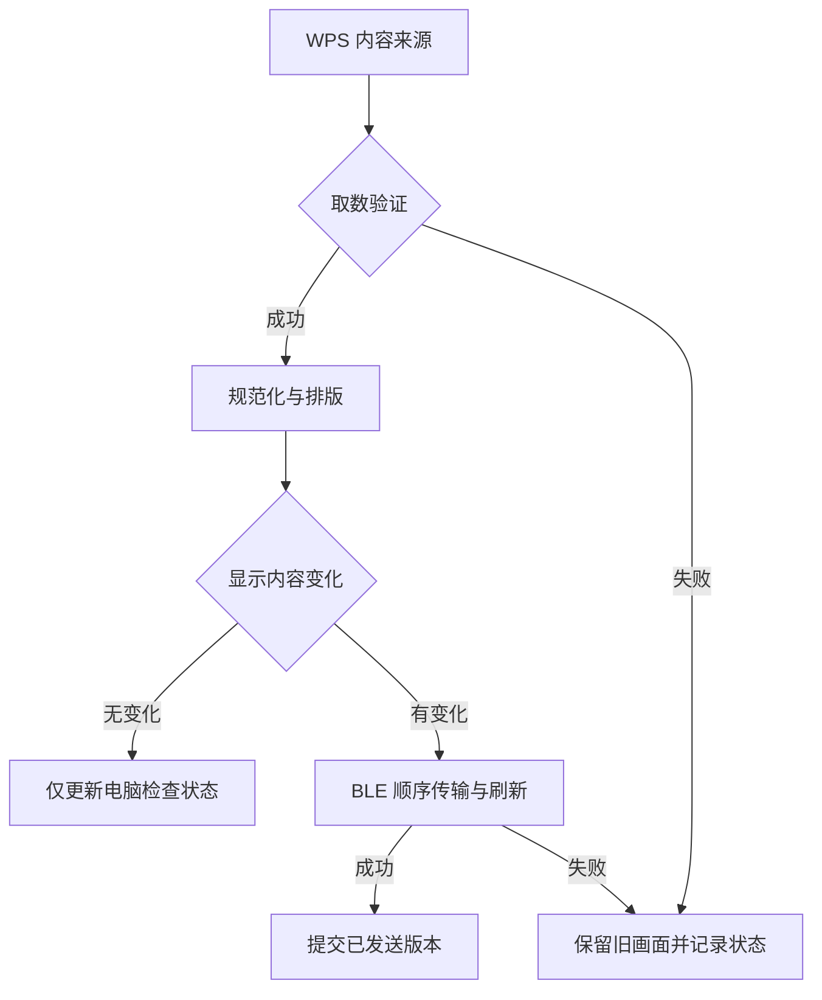

# 墨笺 InkMemo：WPS 云表格蓝牙墨水屏看板 · Codex 开发交接文档

版本：v0.2 需求基线与开发交接版  
日期：2026-11-02（北京时间）  
已确认仓库名：`inkmemo-epd`  
建议仓库归属：`MysticRichard/inkmemo-epd`（沿用用户已有 GitHub 用户名，尚未创建，也未核查名称是否被占用）  
文档用途：交给后续 Codex，在本次已确认需求基础上继续验证、构建与验收。

> 本文整合了初版规划及用户 Q1–Q22 的逐轮回答，取代 v0.1 中与之冲突的默认建议。本轮只导出文档，没有创建远程仓库、实现应用、连接私人 WPS 文档或刷写屏幕。第 2 节是已确认需求；第 15 节区分技术验证、设计待定与容量实测，不得自行将这些事项标记为已验证或用户已选定。

**后续 Codex 先读：第 2 节需求边界 → 第 5 节云端取数 → 第 8 节 BLE 正确性约束 → 第 12–13 节实施与验收 → 第 15–16 节待定项与交接指令。**

与 v0.1 相比，三项关键变更：正式路径不依赖 WPS 桌面客户端或本地自动同步副本；不新增状态列，完成事项由用户从源表删除；不默认分页、截断或仅展示前 N 条，优先完整展示五类信息，容量策略通过真机测试确定。

## 1. 项目定义与命名

### 1.1 一句话定义

墨笺 InkMemo 是运行在 Windows PC 上的个人墨水屏同步助手：后台通过本机网络自动读取指定 WPS 共享表格，将待办及进行中的事项按计划截止日期排序，整理成适合 7.5 寸墨水屏的画面，再通过电脑蓝牙发送给已有 nRF_EPD 看板。WPS 桌面客户端不启动、文档未手动打开时，正式同步流程也必须成立。

### 1.2 命名与发布规划

| 项目 | 规划值 | 说明 |
| --- | --- | --- |
| 中文名 | 墨笺 | 用户 Q21 已确认 |
| 英文名 | InkMemo | 用户 Q21 已确认 |
| GitHub 仓库名 | `inkmemo-epd` | 用户 Q21 已确认 |
| Windows 显示名称 | 墨笺 InkMemo | 托盘、快捷方式、安装程序统一 |
| Python 包名 | `inkmemo` | 内部模块命名 |
| 命令行入口 | `inkmemo` | 计划提供，当前不存在 |
| 进程/程序名 | `InkMemo.exe` | 首版面向 Windows x64 |
| 首个技术验证版本 | `v0.1.0` | 本地样例 → 排版 → 蓝牙 → 真机 |
| 首个云同步试用版本 | `v0.2.0` | 至少一种真实 WPS 云端自动读取路径通过验证 |
| 日常使用版本 | `v1.0.0` | 后台运行、故障恢复、配置备份与长期验证通过 |
| 推荐开发方式 | 独立伴生仓库 | 协议兼容上游，首版不维护整套固件分支 |

项目名与仓库名已确认；组织归属、仓库公开性与实际创建尚未确定。不要将拟议的 GitHub 地址写成已经存在的项目链接。本文的 v0.2 是文档版本，与未来应用版本 `v0.2.0` 分别管理。

### 1.3 衍生关系

- 上游：[YCD12/nRF_EPD](https://github.com/YCD12/nRF_EPD)。
- 上游沿用的基础项目：[tsl0922/EPD-nRF5](https://github.com/tsl0922/EPD-nRF5)。
- InkMemo 重点新增 Windows 端的取数、任务模型、排版、定时同步和原生 BLE 客户端。
- 硬件继续使用 nRF_EPD 的图片显示能力，不把 WPS 登录、中文文档解析或网络请求放到屏幕 MCU。
- 将来如果必须改固件，再规划 `inkmemo-nrf-epd` 独立 fork，并记录基线与差异；首版不同时启动两个仓库。

## 2. 已确认需求、建议默认值与边界

### 2.1 已明确需求

1. 用户已有一块 7.5 寸墨水屏看板，照片显示其正在展示黑白红日历，右上角有 `NRF_EPD_XXXX` 标识。
2. 以 nRF_EPD 为基础做衍生项目。
3. 内容来源已确认是 WPS 共享表格，目标是备忘录/事项看板；后续只在这一份共享文档维护。
4. 通过 Windows PC 自带蓝牙传输，不额外要求蓝牙网关。
5. 每半小时自动同步。
6. 当前交付为 Markdown 开发交接文档，后续由 Codex 继续构建。
7. 用户提供的内容样例为表格，列为“责任人、对接人、完成时间、事项、产品”，包含合并单元格、空白分隔行和自然语言日期。
8. 首版一个人使用、一个人维护，不开发多人协作或权限管理。
9. 只同步指定文件中的一个工作表、一个可配置区域；区域内新增有效行自动纳入。五类字段都必须展示，不默认按责任人、产品或当天/本周筛掉事项。
10. 源表只保留待办与进行中事项；完成后用户直接删除，不增加状态列，不维护第二份独立事项清单。
11. “完成时间”按计划截止日期理解，屏幕排序为：已逾期 → 今天到期 → 未来截止日期从近到远 → 日期含糊/未填写；同一天按原表顺序。
12. 根据临近程度提供视觉提醒；红色、加粗、旗标等具体表现留待排版设计。未来 3 天作为可配置建议值，不将其写成不可更改的已确认阈值。
13. 通过紧凑布局与有限缩小字号尽量避免分页。极限容量及溢出行为由后续真机测试决定；没有批准自动隐藏、裁断、分页或只显示前 N 条。
14. WPS 客户端没有启动时也必须自动取数。用户接受首次登录/授权及会话失效后重新登录，不接受日常手动打开、下载或导出。
15. PC 正常运行时每半小时检查，源内容或截止日提醒变化时更新；PC 关机/休眠期间无需更新，恢复后补做一次最新检查。
16. 表头正常且确认没有事项时显示“暂无待办”；不能把取数失败当作空表。
17. 同步失败优先保留原事项；读源失败且蓝牙可用时可发送带失败页脚的缓存画面；蓝牙失败时只能在 PC 提示，恢复成功后清除失败提示。
18. 首版不新增付费订阅、不租服务器，先做好个人自用版本。

### 2.2 本文采用的建议默认值

| 项目 | 默认建议 | 状态 |
| --- | --- | --- |
| 文档类型 | WPS 共享表格，已确认 | 具体云表格子类型、导出格式与实际文件 ID 仍需验证 |
| 屏幕规格 | 横向 800×480、黑白红 | 与上游主线接近，待实机核对 |
| 主机 | Windows 11 x64，用户登录后后台常驻 | 待确认实际 Windows 版本 |
| 同步周期 | 程序启动后每 1800 秒检查一次 | 用户要求半小时；整点对齐可另议 |
| 刷新条件 | 事项、顺序、临近提醒或失败提示变化时刷新 | 设备恢复/健康核验另有受限例外 |
| 默认展示 | 中文事项表，保留五类信息 | 不直接缩小整张办公截图 |
| 内容容量 | 紧凑布局、有限缩小字号、尽量不分页 | 极限溢出策略尚未决定，必须先实测 |
| 屏幕模式 | 图片模式 | 避免固件日历/时钟覆盖事项 |
| 首版设备数 | 1 台 PC + 1 块屏幕 + 1 个文档 | 保持可维护性 |
| 云读取 | 本机直接联网取云端数据，不依赖 WPS 客户端 | 官方 API / 独立浏览器自动化在 P0 验证后选择 |
| 启动 | 建议墨笺在 Windows 用户登录后自启 | 不启动 WPS，不默认要求注销状态下运行的系统服务 |

### 2.3 首版包含

文档源配置、字段映射、中文排版预览、手动同步、30 分钟检查、变化去重、蓝牙发现与绑定、失败重试、离线保留上次画面、同步状态与脱敏日志。

### 2.4 首版不包含

屏幕触摸编辑、向 WPS 回写、状态列/完成按钮、第二份本地事项编辑器、实时秒级同步、多人权限系统、手机 App、云端中转服务、AI 摘要、复杂富文本还原、多屏批量管理、自动固件升级、快速轮播。

首版只读用户指定文档，不改变 WPS 原表排序。不根据颜色或删除线猜测完成状态。无年份日期必须依据用户可见的看板年度配置解释，未配置年度时不自动认定；含糊日期不猜测。

### 2.5 使用前提

- PC 开机、处于正常运行状态且蓝牙可用时，才能定时更新。
- PC 休眠、关机或蓝牙关闭时，停止更新；墨水屏通常能保留原有画面。
- PC 恢复运行后补做一次最新内容检查，不补放错过的每个历史周期。
- “每半小时同步”定义为每半小时发起一次内容检查，并在成功取数、传图及刷新后更新画面，不是任何情况下严格 30 分钟内必达。
- 不默认阻止 Windows 休眠，也不默认设置自动唤醒；需要时另行讨论。

## 3. 上游核查与可行性

### 3.1 核查基线

核查日期：2026-11-02。使用 GitHub 连接器读取 `main` 分支，返回的最新提交为：

`e86495e25fe69de1c7174b5913aa294c2103242e`

提交日期为 2026-04-03；消息为 `Refine web DFU flow and diagnostics`。该值用于记录本次阅读基线，不代表用户屏幕已经运行此版本。后续开发开始前重新核查上游变化，并将实际使用的提交写入 `docs/upstream-baseline.md`。

### 3.2 已核实能力

上游主线定位为 nRF52811，默认模型 ID `0x07`，7.5 寸 UC8179 黑白红屏，分辨率 800×480。其网页工具已经支持图片传输，因而 PC 端渲染后传图具备现成技术基础。[S1]

上游提供图片模式、版本读取、初始化、电压通知及分块传输命令。实际命令行为以本次基线的固件与网页源码为准；协议说明文档没有覆盖所有传图细节。[S2–S6]

### 3.3 仍未核实

| 待核实项 | 为什么重要 | 验证方式 |
| --- | --- | --- |
| 屏幕实际型号/驱动 | 同为 7.5 寸可能具有不同分辨率与驱动 | 读取现有网页配置，必要时查设备背面标签 |
| 实际 MCU 与固件版本 | 照片无法确定固件协议能力 | BLE 服务发现与版本特征读取 |
| PC 蓝牙适配器及驱动 | 影响 BLE 连接与最大写入长度 | 运行只读诊断与测试传图 |
| 显示方向、颜色极性 | 防止镜像、花屏、红黑反转 | 非对称校准测试图 |
| 广播是否持续开放 | 自动连接可能依赖按钮唤醒 | 断开后分别等待 30/60 分钟再扫描 |
| 刷新后能否稳定重连 | 决定半小时无人值守是否成立 | 多轮真实间隔验证 |
| WPS 实际文档类型与账号能力 | 决定取数路线 | 文档类型和可用导出/同步功能验证 |

### 3.4 判断

“电脑渲染 → BLE 发送 → 墨水屏显示”有明确上游基础；“指定 WPS 云文档无人值守读取”和“用户设备每次可自动重连”仍是必须先验证的两项。当前结论为**方案可进入技术验证阶段，尚未实机打通**。

## 4. 方案比较与推荐架构

### 4.1 Windows 程序形态

| 路线 | 优点 | 代价 | 本次建议 |
| --- | --- | --- | --- |
| 扩展上游 Web Bluetooth 网页 | 可快速复用网页操作流程，适合人工测试 | 浏览器授权、页面生命周期和后台运行需要额外处理 | 留作诊断工具 |
| Windows 原生 BLE 后台助手 | 与浏览器页面独立，适合定时重连与后台任务 | 需新增 PC 程序和打包 | 推荐 |
| 增加 ESP32/树莓派网关 | 可脱离 PC 持续工作 | 新硬件、联网配置和维护，改变当前需求 | 后期另议 |

Web Bluetooth 的首次设备选择与访问受浏览器安全和权限机制约束。[S11] 选择原生客户端是基于后台运行需求的工程建议，并不意味着浏览器完全无法自动重连。

### 4.2 推荐组件

| 层 | 首选建议 | 作用 |
| --- | --- | --- |
| 核心运行时 | Python 3.12 x64，具体补丁版本开发时锁定 | 取数、调度、数据转换 |
| 原生蓝牙 | Bleak，使用 Windows WinRT 后端 | 扫描、连接、特征读写、通知 |
| 图像渲染 | Pillow + 可再分发中文字体 | 精确像素排版与位平面输出 |
| 表格解析 | openpyxl，只读 `.xlsx` | 本地样例及云端自动导出后的解析；不是要求 WPS 同步本地文件 |
| 云端访问 | 官方接口或独立浏览器自动化，P0 二选一 | 用本机网络取得最新云端数据，不依赖 WPS 客户端 |
| 托盘界面 | pystray + 小型配置/预览窗口，具体组合 P2 确定 | 手动同步、状态、退出 |
| 状态保存 | JSON + 原子文件替换 | 一块屏幕无需数据库 |
| 凭证保存 | Windows Credential Manager 或 DPAPI 封装 | API token 等，不写入配置 |
| 分发 | PyInstaller，先目录版再评估单文件版 | 无 Python 环境的 PC 使用 |

这些是建议技术选型，尚未安装或锁定依赖。先实现可诊断的核心流程，再做托盘与安装包。暂不引入 Electron、Docker、n8n、Dify 或大模型服务。

Bleak 官方接口支持通知、显式有/无响应写入；GATT 写入尺寸应根据实际特征能力决定。[S10] 实现时保持 BLE 工作线程中的 asyncio 循环稳定，避免每条命令重建事件循环；GUI/COM 的 STA 与 WinRT 异步模型必须按 Bleak Windows 文档处理，不能盲目关闭线程检查。

### 4.3 模块职责

| 模块 | 输入 | 输出 | 不承担的职责 |
| --- | --- | --- | --- |
| SourceAdapter | 云文档配置、本地凭证/会话引用 | 带来源与版本信息的快照 | 不直接控制屏幕，不依赖 WPS 桌面进程 |
| Normalizer | 云表格结构化数据或自动导出的工作簿 | 标准任务集合 | 不改写业务含义 |
| LayoutEngine | 截止日排序后的完整任务、版式配置 | 布局对象与溢出统计 | 不决定云登录方式，不自行筛掉事项 |
| Renderer | 布局、字体、设备规格 | 预览 PNG、黑/红位平面 | 不负责重试 |
| EpdTransport | 位平面、设备配置 | 传输与刷新结果 | 不解析 WPS |
| SyncCoordinator | 调度事件与各模块结果 | 状态更新、重试、日志 | 不存储 WPS 密码 |
| TrayUI | 状态与用户操作 | 配置修改、同步请求 | 不持有 BLE 底层状态 |



## 5. WPS 云端取数：不依赖桌面客户端

### 5.1 已确认的运行约束

用户希望由本地后台脚本联网打开/访问云文档读取数据；没有打开 WPS、没有打开目标表格时也必须成立。“打开云文档”不是要求每半小时在用户桌面弹出一个网页窗口；首次登录和重新授权可以交互，正常轮询应后台执行。

目标文档确定是 WPS 共享表格，但普通云表格/智能表格等具体子类型、真实链接、文件 ID 和授权范围尚未提供。后续 Codex 在 P0 通过用户指定文档验证，不得从截图猜测端点或凭证。

| 路线 | 适用条件 | 优点 | 风险/结论 |
| --- | --- | --- | --- |
| A. 官方云文档接口 | 存在可获授权且满足本地运行、零新增费用的接入方式 | 结构化取数，较少依赖网页布局 | 应用审核、密钥和服务端要求必须先核实，不能预设可行 |
| B. 独立浏览器会话自动读取/导出 | 用户首次登录后，目标表格允许稳定自动导出或通过官方页面读取 | 贴近用户的后台联网访问思路，不依赖 WPS 桌面进程 | 必须验证会话、后台运行、导出和页面变化；不能以手动下载代替 |
| C. 本地 `.xlsx` 样例/缓存 | 仅用于开发离线渲染、传图和故障缓存 | 可独立验证下游链路 | 不构成正式云取数路径，不依赖 WPS 自动同步目录 |

**P0 决策：先核查 A 的实际接入门槛；若要求新增服务端、费用或不可取得的权限，则不投入大规模实现，转而验证 B。只实现经过验证的一个正式适配器，不同时堆叠两套完整方案。** 如果 A/B 均不满足，报告具体阻塞，不擅自改成用户手动导出或启动 WPS 客户端。

### 5.2 路线 A：官方接口验证

官方文档提供个人文件下载授权示例和表格选区读取接口，但示例涉及应用审核与服务端持有密钥；文档存在不代表用户账号已获得调用权限。[S7–S8]

1. 确认使用的是金山文档开放平台还是 WPS 365；不能混用应用身份、token 与端点。
2. 明确实际共享文档的可访问性，限制程序只读目标文档，不将共享链接自动变成公开匿名访问。
3. 优先申请最小读取权限，核对工作表标识、选区边界、显示文字、原值及合并信息。
4. 验证首次授权、自动刷新 token、撤销权限、文档移动/改名和重新登录。
5. 验证关闭 WPS 桌面客户端后仍能自动得到云端另一设备的修改。
6. 云端元信息可信时记录 revision/修改时间；否则以实际内容哈希和成功响应证明本次取数，不伪造云版本时间。
7. 对 401/403 显示授权/权限问题，429 按平台要求退避，网络异常保留缓存。
8. 不把 APPKEY 写入公开仓库或可下载的公共 EXE。若平台要求可信服务端，本地加密密钥不能替代该要求；因首版不租服务器，未找到合规本地接入方式时放弃 A。

本轮没有创建 WPS 应用、登录用户文档或验证账号权益，亦不承诺接口免费、免审核或一定适用于该共享表格。

### 5.3 路线 B：独立浏览器后台自动化

采用用户主动登录的项目专用浏览器 profile。可以选择浏览器自动化工具，但安装、版本与 API 在正式开发时查官方文档锁定；本次没有选定具体工具或安装依赖。

- 首次配置允许弹出登录页面；后续正常运行不抢焦点，不每半小时新开可见窗口。
- 优先使用官方页面的稳定导出功能自动得到 `.xlsx`，再交给相同解析模块。若页面有可验证的结构化读取能力，可用适配器直接转任务模型。
- 自动导出文件是本次联网取数的中间产物，不等于依赖 WPS 本地同步副本；文件必须绑定本轮请求和目标文档，防止读到上轮旧下载。
- 网页表格可能以 Canvas 渲染，不能假设 DOM 里一定有所有单元格，更不能假设打开共享 URL 就能读到完整数据。
- 不以截图 OCR 作为首版主路径；不读取其他浏览器 profile 的私有 Cookie，不绕过验证码、访问权限或使用未公开接口作为默认方案。
- 使用临时文件下载完成事件、文件签名/解析和目标工作表检查确认导出成功；登录页 HTML 不能被当作 Excel。
- 验证页面刷新、关页后恢复、浏览器进程重启、PC 重启登录、锁屏至少一小时和真实半小时轮询。
- 会话失效时停止自动重试登录并通知用户；用户允许重新登录，但不允许每轮人工点击导出。
- 浏览器缓存不能代替云端更新验证。另一设备修改后，自动轮询必须读取到修改，再传给屏幕。

若当前账号/页面无法稳定后台导出，明确标记此路线未通过；不能只交付“辅助同步”就声称满足本需求。

### 5.4 文档选择与增删行

正式配置应选择目标文档、工作表和读取范围。读取范围支持合理的行数上限/整列逻辑，避免新增第 201 行后永久读不到；范围超界必须明确提示。固定样例 `A1:E200` 仅用于调试，不作为用户真实数据规模的认定。

每次读取形成一份完整快照；用户删除某一事项后，下次成功读取应从看板移除；删除最后一条时走第 6.3 节空表保护。不要通过任务 ID 的本地历史记录复活用户已经删除的事项。

### 5.5 SourceAdapter 合约

适配器输出至少包含：`source_id`、`source_kind`、`document_title`、`fetched_at`、`upstream_modified_at`（可空）、`upstream_revision`（可空）、`freshness_basis`、`raw_hash`、目标工作表信息、单元格数据、合并范围、警告列表。

错误统一为：`AUTH_REQUIRED`、`PERMISSION_DENIED`、`SOURCE_NOT_FOUND`、`SOURCE_BUSY`、`NETWORK_UNAVAILABLE`、`RATE_LIMITED`、`UNSUPPORTED_FORMAT`、`SOURCE_UNVERIFIED`。错误和有效空快照必须用不同结果类型表达。

### 5.6 会话与缓存

token、浏览器登录态、原始表格及预览都可能含敏感信息，保存在当前 Windows 用户的本地目录，不提交 Git、不上传第三方 AI。缓存只负责恢复与失败时保留事项；明确标记来源读取时间，不能把读取缓存记为云端读取成功。

## 6. 数据模型与截图适配

### 6.1 核心字段

| 字段 | 类型/含义 | 截图映射 |
| --- | --- | --- |
| `source_ref` | 文档、工作表、原始行号 | 可追溯定位 |
| `task_id` | 文档身份+工作表+行定位形成的暂时标识 | 行号变化时不承诺跨版本稳定 |
| `owner` | 责任人 | 责任人 |
| `counterpart` | 对接人 | 对接人 |
| `due_text` | 原始显示字符串 | 完成时间 |
| `due_date` | 可空的完整 ISO 日期 | 只有足够信息时填写 |
| `due_precision` | exact / month / ambiguous / none | 防止误报逾期 |
| `content` | 事项原文 | 事项 |
| `product` | 产品或分组名 | 产品 |
| `source_order` | 原始行次序 | 同截止日时保持原表顺序 |
| `due_bucket` | overdue / today / upcoming / undated | 根据截止日和本地日期派生，不是完成状态 |

### 6.2 解析规则

1. 支持配置标题行、工作表名与读取范围；范围示例 `A1:E200`，不是对真实文档范围的认定。
2. 标题优先按文字映射，允许列重新排序；五个已确认表头都必须能识别，任一缺失或映射失效时终止该轮并提示，不自动删除该字段或输出空白看板。个别事项行的某字段为空不等于表头缺失。
3. 只在实际合并单元格覆盖范围内传播锚点值。例如产品跨行合并，将产品名赋给覆盖到的事项行；不能把所有空白责任人或日期一律向下填充。
4. 全空行跳过；有事项但缺少日期或产品的行仍保留，并标记字段缺失。
5. 保留中文标点、型号及原文数字，不通过 AI 改写技术事项。
6. `3.18前` 保留原文；若用户明确设置 `document_year`，可按该年度解析为截止日。未配置年度时不自行推断。`4月前` 含义不明确，不自动解释为 4 月 1 日；不因当前日期是 2026 年就把截图任务判为已逾期。
7. Excel 序列日期必须结合工作簿日期系统转换；完整日期及依据显式看板年度解析出的日月日期可参与排序。跨年度任务填写完整年份，系统跨年后不静默改变现有看板年度。
8. 公式读取优先使用已保存缓存结果；openpyxl 不负责重新计算公式。没有缓存时提示该单元格需要 WPS 重新计算保存，不能把公式字符串当事项或把空缓存当空任务。
9. `.xls`、加密工作簿和宏工作簿不作为首版标准输入；提示导出 `.xlsx`。只读源文件，不覆盖保存。
10. 本地文件先复制为稳定快照后解析；文件大小/修改时间在短暂间隔内稳定且解析成功才提交。被占用或下载中时重试，避免读半个文件。

### 6.3 空内容保护

用户已确认：最后一条事项从 WPS 删除后，屏幕显示“暂无待办”，保留数据时间。该画面必须来自成功的云端读取，不能由异常处理返回空数组触发。

确认条件至少包含：本次授权有效、目标文档/工作表正确、表头五字段识别正常、目标范围完整读取、没有下载中或解析错误。若从非空突变为零事项，可在同一轮额外读取一次以排除瞬态；具体技术实现由构建者决定，不要求用户每次删除后手动确认。

表头缺失、目标区域失效或响应异常属于失败，保留缓存事项并进入失败提示流程。正常成功快照中的删除立即生效，不用固定减少比例阻止用户批量清理已完成事项。

### 6.4 截止日排序与提醒

使用 `Asia/Shanghai` 本地日期判断：`due_date < today` 为逾期，等于今天为今天到期，大于今天按日期升序，无法明确解析日期的放在最后。逾期内部也按截止日升序；相同日期或同属未定日期时，以 `source_order` 稳定排序。

排序只作用于屏幕，不写回源表。每次半小时检查重新计算到期分类，即使云端内容没变化，跨日后顺序/提醒变化也必须纳入显示去重。无新鲜云数据时，允许对缓存事项重算日期分类，但始终保留原数据时间和失败提示。

未来 3 个自然日作为临近窗口的建议初值并允许配置；确切窗口及视觉规则在设计时确认。先把“逾期、今天、临近、正常、日期未定”做成语义标记，再由模板决定红色、粗体或旗标，避免业务代码固定某一种样式。

## 7. 墨水屏版式

### 7.1 默认方向

采用为屏幕重新排版的事项表，用户已接受调整布局。用户截图中的五类信息全部保留；显示顺序暂建议为“产品、事项、完成时间、责任人、对接人”，最终列顺序、分组、列宽与网格样式待设计，不等于强制照搬原表。

| 区域 | 初始尺寸建议 | 内容 |
| --- | --- | --- |
| 画布 | 800×480 | 必须由设备 profile 决定 |
| 左右边距 | 各 24 px | 表格宽 752 px |
| 上下边距 | 各 16 px | 避免贴边 |
| 标题 | 高 48 px | 文档名/自定义标题 |
| 表头 | 高 32 px | 字段名称 |
| 内容 | 约 340 px | 按实际文字动态计算行高 |
| 页脚 | 高 28 px | 画面数据时间、事项数、必要时失败提示 |
| 列宽 | 80 / 380 / 100 / 96 / 96 px | 依次为产品/事项/日期/责任人/对接人 |

正文常规建议 20–22 px，标题 28–32 px；紧凑模式可先探索正文最低 18 px，均为待测试建议，尚未确定阅读下限。中文按实际字宽换行，行高由各列最大内容决定，禁止跨行覆盖。日期显示保留“前”等限定词。以真实观看距离和真机效果确定字号，不按预览图主观宣称可读。

### 7.2 颜色和像素规则

- 以纯白背景、黑字、少量红色强调为主。
- 使用红色、加粗、旗标等体现截止日提醒，具体样式待设计；含义不明确的日期不染成逾期，不自行推断业务优先级。
- 细网格至少保证最终位图上有完整 1 px 线条，不用低对比灰色细线。
- 字体抗锯齿在绘制阶段使用，最终转换为明确黑/白/红三色；文字不做照片式抖动。
- 黑红像素互斥；白色像素两个平面均为非着色值。
- 不默认显示秒表或每分钟时钟，以免造成额外刷新。
- 页脚显示“画面数据时间/来源时间”的明确含义；不要显示需要每次检查变化的“刚刚同步”动态文字。

### 7.3 紧凑排版与极限容量

用户明确尽量不分页，接受紧凑排版和有限缩小字号；尚未接受在极限时只展示前 N 条。执行顺序为：

1. 五类字段和全部有效事项先完整布局，按已确认的截止日规则排序。
2. 减少不必要边距、行间距、表头装饰；合理重分列宽和文字换行，探索紧凑单行/多行结构。
3. 必要时在经过真机验证的范围内分档缩小字体；每档重新测量，不能把整张位图任意缩放导致细线/字形消失。
4. 输出容量诊断：事项数、内容行数、最小字号、长文本占用、预计溢出高度及是否可完整显示。
5. 若达到实测可读下限仍不能完整显示，返回明确 `LAYOUT_OVERFLOW`，记录测试结果后与用户确定处理方式。不要私自启用分页、删除字段、截断正文或隐藏低排序事项。

在最终容量策略未确认前，开发保护行为是：不向真机自动发送删减版画面，在 PC 预览明确报告超限，暂保留上次完整有效画面并标明本轮未更新。此行为是验证阶段的保守处理，不是用户已经选定的长期溢出方案，也不能据此宣称已满足容量要求。

使用 10/15/20/30 条、包含不同长度事项的虚构样例评估；数量仅为测试梯度，不代表这些行数一定能显示。单条超长事项同样必须纳入测试。容量上限和最终模板通过真机确认后写入 `docs/layout-validation.md`。

## 8. BLE 协议适配细则

### 8.1 服务与特征

本次基线的网页源码与固件头文件对应以下 UUID：[S3–S4]

| 用途 | UUID |
| --- | --- |
| EPD 服务 | `62750001-d828-918d-fb46-b6c11c675aec` |
| 命令写入/通知 | `62750002-d828-918d-fb46-b6c11c675aec` |
| 应用版本读取 | `62750003-d828-918d-fb46-b6c11c675aec` |

扫描先按设备名候选显示，再通过服务发现核验，不能假定广告包一定包含服务 UUID。`NRF_EPD_XXXX` 是照片中的标识候选，不等于已经确认的完整蓝牙名称或 MAC。

首次用户选择设备后记录 Windows 设备地址/标识与硬件 profile。每轮优先扫描后用返回的 BLEDevice 对象连接；同名设备不自动替换。设备地址变化时提示重新绑定，不默认要求在 Windows 设置里配对；是否配对由实际 GATT 安全要求决定。

### 8.2 使用的命令

| 命令 | 值 | 首版用途 |
| --- | --- | --- |
| INIT | `0x01` | 初始化已核实的驱动，取得通知 |
| REFRESH | `0x05` | 两个平面完整后触发刷新 |
| SET_MODE | `0x22` | 按实际固件兼容性处理，不每轮重复写配置 |
| SYNC_TIME_SILENT | `0x23` | 仅确认版本支持后选用，非首版同步必需 |
| WRITE_IMAGE | `0x30` | 旧协议兼容路径，无应用级 CRC 确认 |
| WRITE_BLOCK | `0x31` | 顺序分块 + CRC + 应用级 ACK |
| QUERY_STATUS | `0x32` | 检查当前层的块计数/位图 |
| RESET_TRANSFER | `0x33` | 开始一个新层的传输状态 |

`0x20` 校时会触发刷新，首版不在连接时随手发送。静默校时要求固件版本至少 `0x21`；网页以版本至少 `0x20` 选择 CRC 路径，但未知固件不能只凭数值就假定完全兼容，仍须实际验证。

默认不发送引脚配置、擦除配置、MCU 关机、系统复位或 DFU 命令。照片里设备已正常显示，首选复用现有硬件配置。

### 8.3 位图格式

800×480，每个平面每像素 1 bit：

- 每行 `ceil(800/8) = 100` 字节。
- 每层 `100×480 = 48,000` 字节。
- 黑层+红层总计 `96,000` 字节，不含协议头、校验和 GATT 开销。
- 按行从上到下、每行从左到右、每字节高位在前作为待校准初始 profile。
- 上游 UC8179 全刷路径中白底使用 `0xFF`；颜色极性须结合网页转换结果与校准图核对，不能把局刷路径中的红层取反规则混到全刷路径。
- 即使这一帧完全没有红色，也要发送完整“无红色”平面，清掉上次残留的红色内容。
- 不直接发送 PNG/JPEG 文件字节，先转成原生位平面。

校准图至少包含：左上/右上不同文字、四角标记、黑块、红块、白块、单像素边线与中文。第一次传图需目视确认方向和颜色。

### 8.4 CRC 包格式

`[0x31][block_id LE16][total_blocks LE16][cfg U8][payload N bytes][crc LE16]`

- 黑层 cfg：首块 `0x0F`，后续 `0xFF`。
- 红层 cfg：首块 `0x00`，后续 `0xF0`。
- CRC 只覆盖 payload；初始值 `0xFFFF`，逐字节异或、右移，反射多项式 `0x8408`，无最终异或。不要仅凭“CRC16-CCITT”名称套用另一种变体。
- 块 ACK：`[0xA0][block_id LE16][status U8]`；状态 0 成功，1 CRC 错，2 块参数错误。
- 状态：`[0xA1][total LE16][received LE16][session U8][active U8][bitmap…]`。
- `0x33` 可带 1 字节 session，但 `0x31` 数据包自身不携带 session 或帧哈希，不能将其当完整事务身份保证。
- 每层单独 reset、发送、检查；位图只代表当前层，不同时代表两个平面。

### 8.5 包长与 512 块限制

固件最大块数为 512。设 `G` 为当前实际可安全写入的 GATT 特征值最大字节数：

`payload_size = min(G - 8, 248)`  
`blocks = ceil(48000 / payload_size)`

其中 248 来自本次基线的 256 字节命令队列上限减去 8 字节 CRC 包开销。G 同时受 ATT MTU、特征能力、固件限制与实测结果约束，不能直接照抄网页输入框默认值。

- 要让单层块数不超过 512，payload 至少为 94 字节，即 G 至少 102 字节；对应 ATT MTU 至少 105 字节只是必要条件之一。
- 例如确认 G=244，则 payload=236，单层 204 块；G=20 时 payload=12，单层 4000 块，无法用当前 CRC 路径发送一整层。
- 固件通知 `mtu=<n>` 实际发送的是 `max_data_len`，并非应再次减 3 的原始 ATT MTU；实现中分别命名 `att_mtu` 与 `gatt_value_limit`。
- Bleak 无响应写入上限以特征的 `max_write_without_response_size` 为准；有响应写入也需验证设备实际接受值，不假设可以自动发送任意 512 字节。
- 确认后的模式使用其对应限制；若同时使用两种写法，取两者安全限制的较小值。
- 如果无法获得足够 G，CRC 模式明确拒绝传输。可由用户选择经验证的 `0x30` 旧协议兼容模式，不能失败后静默降级成无校验传输。

上游网页存在 `Math.max(mtu - 8, 20)` 的分块计算；当 G 很小时可能超出允许包长。新客户端重新计算并检查边界，不逐字移植。

### 8.6 不照搬任意缺块补发

源码中，CRC 成功后直接调用 `write_ram(cfg, payload)`；UC8179 的写 RAM 函数只有“开始一层/继续一层”，没有根据 block_id 设置屏幕 RAM 偏移。若先跳过第 10 块、继续写第 11 块，最后再补第 10 块，位图可以齐全但画面顺序可能错误。[S4–S6]

因此首版策略为：

1. 一个时刻只发一个块，收到匹配应用 ACK 后再发下一个。
2. GATT write-with-response 只说明蓝牙写操作结果，不等于 MCU 已执行 RAM 写入；仍等待 `0xA0`。
3. CRC 错误、ACK 超时、断连、块参数错误、位图不一致均终止该轮；断开旧 BLE 连接，清空通知等待器与接收缓存，再新建连接、重新订阅，从黑层起点完整重传两个平面。不能只在旧连接发送 reset 后立刻重用块号。
4. 不跨断连续传，不在未知 RAM 指针状态下仅补缺块，不并发发送黑红层。
5. 不在首块 ACK 丢失时直接重复首块并沿用原上下文；当前固件收到 block 0 会重置计数与位图。
6. 确认单帧完整、两个平面正确后才刷新。先追求正确，再考虑实测后的批量提速。

通知等待器同时绑定本机连接代次、当前层和预期块号；旧连接回调一律丢弃。ACK 本身没有层或 session 字段，这些本机标签不能补出协议没有的身份信息，所以异常后必须更换连接。正常切换图层前，确认上一层没有未完成等待器，reset 后查询并确认预期 session/空传输状态，再开始新层；如果收到无法解释的 ACK 或状态，终止该轮而不猜测归属。

这不是对所有 nRF_EPD 衍生固件的统一结论；如果用户固件实现不同，重新审阅并单独登记能力。

### 8.7 一轮完整 BLE 流程

1. 获取该设备独占同步锁；确认没有网页控制台、手机工具或另一个进程占用。
2. 扫描、匹配已绑定设备、连接、发现服务、开启通知、读取版本与当前配置。
3. 校验型号与 profile；INIT 默认不附带新型号，避免无意改写既有配置。等待初始化的时间/电压/包长通知，校验其来源和超时。
4. 电压未知时诊断提示；本次上游在 `<=2800mV` 有低电量保护，首版默认不在该电压范围继续自动传图；`<2700mV` 可能进入 SYSOFF，需要恢复供电及相应唤醒。[S2]
5. 重新核定有效 G，检查块数与包长；选择已验证协议配置。
6. 黑层 reset → 顺序块+ACK → 查询位图/计数，红层重复相同流程。
7. 两层通过后写 REFRESH。等待经过实测的刷新保护时间/可用完成证据，再结束连接；不得在 GATT write 返回瞬间就断开。
8. 提交这一帧的发送结果和哈希，释放锁。

上游 REFRESH 没有独立“像素已正确显示”回执，驱动存在等待 BUSY 的超时路径。因此状态要区分“数据传输确认”“已请求刷新”“刷新等待结束”和“硬件目视验证”。如果用后续查询作为命令队列屏障，须实测其行为；不能把普通查询结果等同真实显示校验。

刷新期间发生断连或超时，标记 `refresh_uncertain`，不提交为明确成功，也不立即连续重刷。等待保护时间后再次连接处理；重试期间保留画面但不能保证掉电或硬件故障下的像素完整。

## 9. 定时调度、去重与故障恢复

### 9.1 调度规则

- 常驻进程负责调度；Windows 任务计划程序只用于登录时启动该进程，不同时再建一个每半小时运行的重复任务。
- 默认启动后立即检查一次，然后以单调时钟每 1800 秒调度。
- 同一设备只允许一轮同步；手动同步与定时触发合并，已有运行时记一个“完成后再检查最新内容”标志，不累积任务队列。
- 单轮最长建议 10 分钟，实际超时拆分为取数、连接、传输和刷新；后续依据真机耗时调整。
- 恢复运行后只有一个补偿检查；快速失败使用有上限退避，不等待下一轮才恢复，也不无限重试。
- 首版在 PC 正常运行期间每半小时检查，不新增工作时段限制；工作时段作为以后可选项。

### 9.2 哈希与提交

至少区分：

| 哈希/时间 | 用途 |
| --- | --- |
| `raw_hash` | 输入快照变化跟踪 |
| `content_layout_hash` | 用于去重：全部事项的排序后可见内容、字体、布局、设备 profile、实际到期语义/视觉结果及失败提示状态；排除每轮检查时间 |
| `frame_hash` | 用于记录实际发送画面：冻结后的页脚数据时间、渲染版本以及黑红位平面字节 |
| `last_sent_content_layout_hash` / `last_sent_frame_hash` | 最近一次按既定标准结束传输/刷新等待的内容版本及对应实际帧 |
| `last_check_at` | PC 最近检查时间，不自动画上屏幕 |
| `last_source_read_at` | 最近成功读取来源时间 |
| `last_transfer_confirmed_at` | 最近两层数据确认时间 |
| `last_refresh_assumed_at` | 在无完成回执时按等待规则记录的预计刷新完成时间 |

先用 `content_layout_hash` 判断是否变化；只有决定要生成新画面后，才冻结对应的数据时间，写入页脚、生成最终位图并计算 `frame_hash`。不要用包含每轮新时间的最终图片哈希反过来决定是否刷新。跨日后的排序/到期提醒变化、进入失败提示和恢复清除提示都属于显示变化，应参与前一个哈希；首版没有自动轮换分页。

蓝牙传输/刷新失败不推进两项 `last_sent_*` 哈希。云取数失败但成功发送了带提示的缓存帧时，可更新“屏幕已发送帧”记录；不得推进“云端最近成功读取时间/版本”。手动“强制重发”可跳过去重。

保留不同状态：`last_cloud_success_snapshot`（最新云端有效快照）、`last_displayed_frame`（最近已发送画面及是否为缓存/失败提示）、`source_health` 与 `ble_health`。不能用一个全局“成功”布尔值覆盖云取数、BLE 传输和显示结果三种含义。

### 9.2.1 设备重启与无变化时的健康核验

仅凭 PC 内容哈希无法知道屏幕是否已重启回日历。因此程序启动、PC 从休眠恢复、重新绑定或已知固件升级后，即使源内容未变，也要核验设备当前配置/模式。核验路径必须在 P0 实测确认；配置中的图片模式也不能证明像素一定正确。

常驻期间建议每 6 小时执行一次轻量设备健康核验，独立于每 30 分钟的读源；不为了核验每次初始化显示控制器。若确认已退出图片模式、检测到设备状态丢失，或在成功重连后无法判断显示状态，则强制发送一次当前完整帧。连接不到设备只记录失败并退避，不当作已恢复。无可靠状态读取的设备 profile，明确采用每次健康核验时强制重发的恢复策略，属于有意增加的保底刷新。

这意味着“无变化不刷新”有设备恢复/健康核验的例外：稳定且状态可核验时不刷新；状态不可知时用受限完整重发换取恢复能力。6 小时间隔为待实测调整的默认值，不承诺发现设备重启也严格在半小时内；如果用户要求该恢复时延，需改成每轮核验并评估蓝牙与电量成本。

### 9.3 失败处理

| 情况 | 行为 |
| --- | --- |
| 内容未变化 | 正常读源轮次跳过传图；启动/恢复/健康核验需要修复设备状态时允许强制重发 |
| 读源失败/认证到期，蓝牙正常 | 保留缓存事项及原数据时间，按第 9.3.1 节更新失败页脚；PC 显示具体原因，认证问题暂停自动登录重试 |
| 没找到屏幕/连接失败 | 建议 30 秒、2 分钟、5 分钟退避，各一次，之后回常规周期 |
| CRC/ACK/状态失败 | 不刷新；整帧重新开始，最多 2 次整帧重试 |
| 刷新结果不确定 | 先等待保护窗口，记录不确定状态，再进入受限重试 |
| 低电量 | 暂停自动传图并通知，不强制关闭固件低电量页面 |
| 表格无效/无法确认空表 | 保留缓存事项并提示；只有确认有效空快照才显示“暂无待办” |
| 有效快照确认为空 | 显示“暂无待办”，保留该次有效数据时间 |
| 排版容量超限 | 不发送自动删减版；PC 报告超限，保留上次完整画面，等待容量策略实测确认 |
| PC 休眠 | 无法运行；恢复后合并补偿检查 |
| 软件重启 | 加载已提交状态与绑定设备，进行一次最新内容检查 |

各层重试共用单轮总次数/耗时预算，避免连接重试×整帧重试×取数重试相乘。失败日志不包含事项全文和凭证。

### 9.3.1 用户已确认的失败提示规则

| 故障 | 墨水屏 | PC 端 |
| --- | --- | --- |
| 云文档读取失败，蓝牙可连接 | 使用最近有效事项快照；页脚显示“同步失败，请检查网络或文档登录”，保留旧数据时间 | 显示具体错误，例如断网、登录过期、无文档权限 |
| 蓝牙连接失败 | 原画面保持；无法写入新的故障提示 | 显示“同步失败，请检查蓝牙、设备电量或距离” |
| 云与蓝牙均失败 | 原画面保持，不声称已更新失败提示 | 同时记录两类故障，不把一类故障伪装成另一类 |
| 故障恢复且完成最新云取数及屏幕发送 | 清除失败提示，显示最新事项；源内容相同也应去掉旧失败标记 | 恢复正常状态 |

失败提示只占用预留页脚，不遮挡、挤掉或修改事项正文。三色全刷路径中，即使只改页脚也要按当前能力发送完整画面，不假定支持局部刷新。相同持续故障的同一缓存画面只更新一次，之后按受限策略重试，不因每轮错误时间变化反复刷屏。

首次运行没有任何成功快照时，不伪造缓存事项；优先保留设备原画面并在 PC 报错。获取过有效快照后才可生成故障缓存帧。PC 关机和休眠不主动追加故障提示，因为此时程序无法运行。

### 9.4 屏幕上的离线时间

PC 关机时无法更新屏幕提示“离线多久”。首版通过静态“画面数据时间”让用户判断新旧，真实在线状态放在 PC 托盘。不要承诺屏幕在 PC 离线后还能自动变更提醒。

### 9.5 电池与刷新频率

全天每半小时最多 48 次检查，但实际刷新次数应远小于检查次数。首版采用三色全刷，记录真实传输耗时和刷新时长。未测量电池容量、广播功耗和刷新电流前，不给出“可用几个月”的续航承诺，也不自行修改刷新 LUT 或低电量阈值。

## 10. 配置、状态与用户操作

### 10.1 初次使用流程

配置云文档 → 首次登录/授权 → 关闭 WPS 客户端验证自动取数 → 选择工作表/范围和列映射 → 设置必要的看板年度 → 预览 → 选择屏幕 → 校准 → 手动同步成功 → 开启半小时自动检查与墨笺自启。

取数验证与蓝牙验证分别显示结果，方便知道问题出在 WPS 还是屏幕。一次性手动测试通过，不自动标记长期无人值守测试通过。

### 10.2 托盘最小功能

立即检查并同步、强制重发、查看当前预览、修改云文档/范围/版式设置、查看最近同步记录、重新登录、暂停/继续、墨笺登录后自启开关、打开配置目录、退出。不增加事项编辑器或完成按钮。可先以后台脚本和配置文件交付开发版；托盘和 EXE 为日常使用的工程建议，不改变核心验收条件。

状态文案面向用户，例如“内容无变化”“需要重新登录 WPS”“未找到已绑定屏幕”“电量低，暂停更新”“已发送，等待刷新”。不要把 ACK、MTU 等协议术语放进正常操作流程；诊断详情中保留。

### 10.3 配置示例（拟议格式）

以下只说明计划的配置结构，不是已经存在的程序接口。`wps_cloud_browser` 仅演示浏览器路线的配置，最终 kind 随 P0 选型确定；不得直接当作已实现适配器。读取范围、云链接、年度和设备绑定均须首次配置：

```json
{
  "schema_version": 2,
  "source": {
    "kind": "wps_cloud_browser",
    "document_url": "CONFIGURE_WITH_AUTHORIZED_DOCUMENT_URL",
    "session_ref": "local-dedicated-profile",
    "sheet": "事项",
    "range": "A:E",
    "max_scan_rows": 1000,
    "header_row": 1,
    "columns": {
      "owner": "责任人",
      "counterpart": "对接人",
      "due_text": "完成时间",
      "content": "事项",
      "product": "产品"
    }
  },
  "device": {
    "identity_ref": "configured-after-discovery",
    "profile": "uc8179-800x480-bwr",
    "transport": "crc_sequential_ack",
    "rotation": 0
  },
  "sync": {
    "interval_seconds": 1800,
    "startup_check": true,
    "skip_unchanged": true,
    "empty_policy": "show_when_verified",
    "on_source_error": "cached_tasks_with_notice_if_ble_available"
  },
  "layout": {
    "template": "task_table",
    "title": "工作备忘",
    "timezone": "Asia/Shanghai",
    "density": "adaptive_compact",
    "pagination_enabled": false,
    "overflow": "report_pending_capacity_validation"
  },
  "due": {
    "document_year": null,
    "near_due_days": 3,
    "sort": "overdue_today_upcoming_undated"
  }
}
```

`max_scan_rows=1000` 是示例技术保护值，不是已确认的数据容量。超过读取上限必须告警，不能静默当作表格结束；屏幕可读容量由第 7.3 节真机测试单独决定。`near_due_days=3` 为可配置建议值。

默认数据目录 `%LOCALAPPDATA%/InkMemo/`。配置、状态、浏览器会话、预览和轮转日志分开保存。配置写临时文件后原子替换，状态仅在相应阶段成功后更新；保留一个上一版本用于恢复。敏感凭证通过系统凭证引用或受保护的项目会话读取，不出现在 JSON 中。

## 11. 仓库结构与维护约定

建议结构如下，以路径表表达；本轮未生成应用脚手架：

| 路径 | 内容 |
| --- | --- |
| `README.md` | 定位、设备条件、快速开始、限制 |
| `LICENSE` | 计划采用 GPL-3.0，发布前核对继承文件声明 |
| `THIRD_PARTY_NOTICES.md` | 上游、依赖、字体来源与许可 |
| `pyproject.toml` / 依赖锁文件 | 构建配置与可复现依赖 |
| `src/inkmemo/sources/` | 已验证的 WPS 云适配器；本地样例仅供开发调试 |
| `src/inkmemo/domain/` | 标准任务、截止日解析、排序与提醒语义 |
| `src/inkmemo/render/` | 布局、字体、位平面 |
| `src/inkmemo/ble/` | UUID、协议编解码、顺序传输、Windows 诊断 |
| `src/inkmemo/sync/` | 调度、去重、预算与状态提交 |
| `src/inkmemo/ui/` | 托盘、配置、预览 |
| `src/inkmemo/storage/` | 配置、状态、系统凭证封装 |
| `profiles/` | 设备规格与已验证能力 |
| `assets/fonts/` | 可再分发字体与许可证 |
| `tests/fixtures/` | 虚构样例、合并格/日期/公式样本 |
| `tests/unit/` | 数据转换、位图、CRC、状态机 |
| `tests/integration/` | 传输模拟、文件更新等集成验证 |
| `docs/architecture.md` | 模块边界和决策 |
| `docs/wps-source-validation.md` | 账号/文档类型验证结果，不含凭证 |
| `docs/ble-protocol.md` | 基线及客户端兼容规则 |
| `docs/upstream-baseline.md` | 上游提交与变更追踪 |
| `docs/hardware-validation.md` | 真机型号、方向、包长、耗时、广播验证 |
| `docs/layout-validation.md` | 常规/紧凑版式、字号可读性、容量梯度与待定溢出策略 |
| `docs/decisions.md` | 已确认选择及变更原因 |
| `scripts/` | 打包与登录自启管理脚本 |

推荐仅保留 `main` 稳定分支和短期 `feat/*` 分支，按里程碑打标签，暂不维护长期 `develop`。协议引用固定提交，不直接跟随上游最新分支自动更新。

上游根目录为 GPL v3 许可证文本，部分文件还保留 Nordic 原始许可声明。计划采用 GPL-3.0 以便复用上游传输逻辑，保留来源、变更说明和文件内许可；SDK、工具二进制与字体分别核对分发条件，不把根目录许可证当作所有第三方文件唯一许可。[S12] 首版 PC 仓库不复制整套 Nordic SDK。

## 12. 开发阶段与交付物

工期仅为规划量级：熟悉环境后，每个阶段可能需要数个工作日；WPS 审核、设备休眠问题等外部等待不纳入固定承诺。

| 阶段 | 工作 | 交付物 | 通过条件 |
| --- | --- | --- | --- |
| P0 约束验证 | 验证无需 WPS 客户端的免费本机云取数；读设备配置/版本；验证广播与重连 | 云来源验证记录、硬件 profile 草案、技术决策 | 关闭 WPS 后，另一设备修改能被后台自动读取；蓝牙可连接，否则明确阻塞 |
| P1 本地显示闭环 | 虚构 `.xlsx` → 标准任务 → 800×480 预览 → 两层顺序传输 | CLI 原型、校准图、一次真机显示记录 | 中文、红黑、方向正确；异常传输不主动触发刷新 |
| P2 自动运行 | 调度、跨日重算、去重、互斥、失败缓存页脚、受限重试、重启恢复 | 可后台运行的开发版本 | 无变化不重复刷屏，半小时触发；故障/恢复提示正确，无限重试被限制 |
| P3 WPS 闭环 | 实现/接入已选源，验证另一设备修改到屏幕更新 | 云同步试用版 `v0.2.0` | 全程无人工导出，真实云更新在下一次成功轮询后显示 |
| P4 版式与日常交互 | 真机紧凑布局、容量梯度测试；预览、托盘、自启、打包与诊断 | 版式测试记录、Windows 可用包、使用说明 | 五字段完整可读，容量边界与用户确认；日常运行不打开 WPS |
| P5 长期验证 | 24/72 小时运行，工作日使用，断网/休眠/低电量观察 | 验收报告、限制清单 | 关键用例通过；据实决定是否发布 `v1.0.0` |

P0 内可先用官方网页完成一张手动测试图，帮助确认硬件，不等于项目已实现。P1 的本地闭环可独立推进，但 P3 没通过就只能称本地同步工具。初始版式应在 P1 可预览，最终容量与视觉样式在 P4 经真机确认；其他屏幕适配和固件提速排在闭环之后。

## 13. 验收与测试矩阵

### 13.1 自动化验证重点

| 领域 | 必测用例 | 预期 |
| --- | --- | --- |
| 表格 | 产品合并格、空白分隔、缺失人员、列顺序变化 | 事项不丢失、不错误继承字段 |
| 日期 | 完整日期、序列日期、无年份日期及有/无显式年度、`4月前` | 未设年度不猜；已设年度可解析日月；月级模糊日期保留原文 |
| 排序/跨日 | 逾期/今天/未来/未定日期、同日多条、源内容未变但跨日 | 顺序稳定，截止提醒自动重算，不回写 WPS |
| 删除/空表 | 删除一条、删除最后一条、登录页或错误响应 | 删除项不上屏；真实空表显示“暂无待办”，错误不当空表 |
| 版式 | 五字段、长文本、紧凑字号、容量超限 | 无静默截断/隐藏/分页；超限返回明确诊断 |
| 公式 | 有缓存/无缓存 | 无缓存报可理解警告 |
| 位图 | 四角、单像素线、纯黑/纯红/纯白 | 每层 48,000 字节，方向/位序符合 profile |
| CRC | 固定向量、JS/C 对照 | 与本次上游算法一致，例如 ASCII `123456789` 应为 `0x6F91` |
| 包长 | G=20/102/244 等边界 | 不超包长，>512 块明确拒绝 CRC 模式 |
| 顺序传输 | ACK 延迟、丢 ACK、NACK、断连 | 不越序补块，不在失败后刷新，整帧预算受限 |
| 双层 | 黑层成功红层失败、红色消失 | 不显示半成品，重试从完整帧起点开始 |
| 去重 | 同内容新读取时间、字体变化、失败提示出现/清除、跨日提醒 | 相同画面不刷；提示状态变化可刷新，缓存帧不更新云成功时间 |
| 状态保存 | 写入中断、程序崩溃、重启 | 不把失败帧标记已完成 |

### 13.2 真机与端到端验证

1. Windows 扫描并连接正确屏幕，版本、驱动和显示方向记录完整。
2. 照片所示五字段事项，能够以可阅读字号显示；紧凑和长文本样例不丢列、不遮挡，极限容量测试有记录。
3. 关闭 WPS 桌面客户端、不手动打开目标文档，从另一设备修改实际共享表格，PC 后台自动读取，下一次成功检查后屏幕显示新内容。
4. 在 PC 正常运行和网络可用时，修改到“下一轮检查+传输/刷新”的时延有记录；先以总时延不超过约 35 分钟作为候选目标，若真机达不到则如实调整并说明原因。
5. 连续四次检查事项、提醒和故障状态均不变，不产生四次屏幕刷新；跨日引起提醒变化时能刷新。
6. 锁屏至少一小时，已选云读取路线和蓝牙传图仍能自动运行；浏览器导出路线也必须满足，不能依赖打开 WPS 作为补救。
7. PC 休眠后恢复，仅补一轮最新检查，无补发风暴。
8. 蓝牙关闭、超距、其他客户端占用后恢复，能重新连接；真实 30 分钟间隔至少多轮通过，不能仅缩短周期测试替代。
9. 传输中断时不主动刷新不完整画面；再次成功后整帧正确。刷新中断单独标记结果不确定。
10. WPS 登录失效、取消权限或断网时，缓存事项及原数据时间保留；蓝牙正常可更新失败页脚，持续同一故障不重复刷屏。蓝牙断开只能在 PC 提示；恢复后正确清除屏幕失败提示。
11. 24 小时运行无重复进程、无同步堆积；72 小时进一步验证。日志脱敏、轮转和状态文件大小可控。
12. Windows 重启登录后自启，只启动一个实例；退出/卸载后自启项可清除。
13. WPS 内容保持不变，让屏幕重启并回到日历；在启动/恢复或规定健康核验时恢复事项画面，不能永远被 PC 去重状态挡住。注入旧连接的迟到 ACK，确认不会完成新连接的等待器。
14. 新增行在配置覆盖范围内自动进入看板；超出读取技术上限明确报错，不能静默遗漏。删除最后一条显示“暂无待办”，不会复活缓存旧事项。
15. 同一内容在云取数失败后显示缓存警告；随后云读取成功，即使事项字节相同也清除警告，且更新云成功状态。

不以“单元测试通过”代替真实 BLE、墨水屏刷新和 WPS 端到端验证。

## 14. 风险、限制与最小化处理

| 风险 | 影响 | 首版处理 |
| --- | --- | --- |
| 云表格子类型/导出能力与预期不同 | 取数适配器不成立 | P0 明确实际类型并验证正式路线，不降级为手动下载 |
| 官方应用无法开通/要求服务端 | 无法使用预想 API | 不先写大量 API 业务，记录决策后选替代路线 |
| 屏幕不持续广播 | 半小时自动连接失败 | 真机长间隔验证，必要时才讨论固件调整 |
| 实机协议比上游旧 | CRC 或静默校时不支持 | 能力记录与明确兼容模式 |
| GATT 写入长度过小 | 512 块限制 | 诊断后拒绝 CRC 或选择显式旧模式 |
| MCU 队列只有 8 项 | 高速无响应写可能丢命令 | 首版逐块应用 ACK，不沿用激进批量参数 |
| 固件无显示完成回执 | 软件不能完全确认画面 | 分阶段状态、等待保护、真机验收 |
| 表格比屏幕容量大 | 字号过小或遗漏 | 紧凑排版、有限缩字、真机容量测试；未获确认不自动隐藏/分页 |
| 公司事项隐私 | 数据出现在不当位置 | 本地渲染，不上传第三方分析/AI，日志默认不记正文 |
| BLE 缺少强访问控制 | 附近设备可能连接或改画面 | 记录现有安全能力；本机绑定不等于固件鉴权，增强鉴权另列后期需求 |

预览和原始快照也可能含公司信息，保存在当前 Windows 用户目录；诊断导出默认排除原文、预览及凭证。自动更新不作为首版必需，使用明确版本的本地安装包。

## 15. 已确认决策与尚未确定事项

### 15.1 对话决策索引

| 问题 | 最终结论 | 后续开发不得回退为 |
| --- | --- | --- |
| Q1 | 事项提醒为主，允许重新排版 | 强制原表截图等比缩放 |
| Q2 | 一个文件、一个工作表、可配置区域 | 多文档平台或固定只读历史样本 |
| Q3 | 一个人使用、维护 | 多人权限与协作功能 |
| Q4 | 随电脑运行，关机不刷新 | 新增常开网关作为首版前提 |
| Q5 | 首次登录可交互，日常自动同步 | 每天手工导出/手动同步 |
| Q6 | 个人自用，零新增订阅/服务器费用 | 新租服务器或新增付费服务 |
| Q7 | 五个表头信息全部上屏，行数增长需紧凑布局 | 默认只看一个责任人或删掉字段 |
| Q8 | 唯一内容维护入口是 WPS 共享文档 | 增加本地事项清单并双向同步 |
| Q9 | 不加状态列，完成后从原表删除 | 自动猜完成状态、增加完成按钮 |
| Q10/Q17 | 完成时间就是计划截止日，可排序提醒 | 把该列当实际完成时间或擅猜模糊日期 |
| Q11/Q12 | 后台通过本机网络读取云端，不依赖启动 WPS | 依赖 WPS 客户端自动同步目录 |
| Q13 | 用户重申完成项不留看板；不要求补状态字段 | 强迫维护已完成历史记录 |
| Q14 | 逾期、今天、未来、日期未定的排序 | 默认保留整表原顺序不做截止排序 |
| Q15 | 提醒方式待排版设计，红色/加粗/旗标皆可探索 | 把某个图标或红字方案当用户已定稿 |
| Q16/Q18 | 紧凑排版、有限缩字、尽量不分页；极限容量实测再定 | 默认前 N 条、自动分页或无限缩小 |
| Q19 | 有效空表显示“暂无待办” | 把最后一条删除后仍永远保留旧事项 |
| Q20/Q22 | 保留事项并提示；按云读取与蓝牙不同故障处理 | 蓝牙断开时声称能往屏幕写新提示 |
| Q21 | 墨笺 InkMemo / `inkmemo-epd` | 继续把项目命名列为待选 |

### 15.2 技术验证项：由后续 Codex 查证

正式云适配器、账号接口权限/导出能力、会话持久性、实际文档链接与标识、工作表范围、Windows 版本与蓝牙驱动、实机 MCU/驱动/固件版本、GATT 包长、持续广播、刷新耗时、自动重连、锁屏与重启后运行。

先检查环境和工具能查到的事实；需要用户指定目标文档或登录时，仅获取完成任务所需信息，不要求把密码/token 粘进聊天。没有授权到目标文档时不自动读取用户其他文档。

### 15.3 设计与实测后再确定

- **版式**：列顺序、宽度、网格或其他紧凑结构、普通/紧凑字号、最低可读字号和观看距离。
- **提醒**：红色、粗体、旗标或其他记号的组合；临近窗口的正式默认值，暂以可配置 3 天探索。
- **容量**：典型事项数量与长度、有效一屏容量、容量极限时的长期行为。用户未批准分页、截断或隐藏，须拿实际效果再讨论。
- **日期配置**：首次配置看板年度；有年度才解析无年份日月日期，不自动把所有旧数据归入当前年。
- **分发**：源仓库公开性、最终脚本/托盘/EXE 交付形态、安装包与依赖版本。先保证核心能力，避免为了分发扩大范围。

这些待定项不要求在重新开始时再问一遍已经回答的 Q1–Q22；只在进入对应设计/实测阶段且需要取舍时讨论。

## 16. 给后续 Codex 的交接指令

1. 先阅读本文第 2、5、8、12、15 节；以 v0.2 的用户确认需求为基线，v0.1 冲突默认值作废。
2. 不把本文的配置、命令入口和目录表当成已存在代码；当前交付仅是一份规划。
3. 未收到开始开发的任务前，不自动建 GitHub 仓库、修改固件或访问私人 WPS 内容。
4. 开始开发时先做 P0，分别记录云取数与 BLE 的验证证据；不把推测写成已验证能力。
5. 技术选型尽量保持 Python + Windows 原生 BLE + 本地渲染；若要引入额外服务或修改硬件，先写清原因和新增维护成本。
6. 以独立适配器隔离 WPS，不在传输层写网页登录逻辑，不把业务文案硬编码进驱动。
7. 必须遵守逐块顺序确认和完整帧提交规则；不要直接移植网页端任意缺块补发或静默降级逻辑。
8. 样例全部使用虚构姓名和事项；不能把用户真实表格、令牌或预览提交到公开仓库。
9. 只有完成真实云端修改→后台读取→蓝牙传输→屏幕显示，才能称为云同步闭环。
10. 每个阶段更新决策和验证记录，将“本地闭环”“WPS 闭环”“无人值守验证”分别标记。
11. 不新增状态列，不依赖 WPS 自启，不强制用户每次手动导出；不能通过放松这些条件让验收表面通过。
12. 版式先完整展示五字段和所有有效事项，超限明确诊断；未获后续明确选择前不自动隐藏、截断或分页。
13. 云端取数失败与蓝牙失败分别建模；带失败页脚的缓存帧发送成功，不代表云数据新鲜。

### 16.1 可复制给 Codex 的启动指令

```text
请根据《InkMemo_EPD_Codex_Handoff_v0.2.md》继续构建墨笺 InkMemo。
先检查当前工作区，理解第 2、5、8、12、15 节，再开展 P0 技术验证。
正式需求是：不启动 WPS 客户端也能由本机后台联网自动读取指定共享表格；
每半小时检查，以五字段完整事项和截止日期排序为主，经 Windows 原生蓝牙发送给已有 nRF_EPD 屏幕。
不要重新询问文档已确认的 Q1–Q22，不要默认改成手动导出、本地同步目录或分页隐藏事项。
优先证明实际云读取与真机 BLE 传图能力，再实现调度、缓存、故障提示、紧凑版式和日常交互。
将验证证据、未通过原因、实际依赖版本和下一步记录到项目文档。
```

## 17. 参考来源与核查记录

以下均于 2026-11-02 查阅。GitHub 细节优先来自连接器返回的固定提交文件；官方 WPS 文档只证明平台提供相关接入方式，不代表已为用户开通。

- [S1 上游 README（固定提交）](https://github.com/YCD12/nRF_EPD/blob/e86495e25fe69de1c7174b5913aa294c2103242e/README.md)：项目定位、主线硬件、工具链。
- [S2 BLE 协议说明](https://github.com/YCD12/nRF_EPD/blob/e86495e25fe69de1c7174b5913aa294c2103242e/docs/ble-protocol.md)：初始化、时间命令、低电量。
- [S3 网页主控源码](https://github.com/YCD12/nRF_EPD/blob/e86495e25fe69de1c7174b5913aa294c2103242e/html/js/main.js)：UUID、版本读取、传图和刷新流程。
- [S4 固件服务头文件](https://github.com/YCD12/nRF_EPD/blob/e86495e25fe69de1c7174b5913aa294c2103242e/EPD/EPD_service.h)：UUID、命令、512 块和队列上限。
- [S5 固件服务实现](https://github.com/YCD12/nRF_EPD/blob/e86495e25fe69de1c7174b5913aa294c2103242e/EPD/EPD_service.c)：CRC、ACK、块写入、状态查询、断连与刷新。
- [S6 UC8179 驱动](https://github.com/YCD12/nRF_EPD/blob/e86495e25fe69de1c7174b5913aa294c2103242e/EPD/UC8179.c)：顺序 RAM 写入与刷新；[网页传输模块](https://github.com/YCD12/nRF_EPD/blob/e86495e25fe69de1c7174b5913aa294c2103242e/html/js/ble_transfer.js)：客户端现有分块逻辑。
- [S7 金山文档：个人文件下载接入示例](https://developer.kdocs.cn/server/example/personal-files.html)：应用、审核、OAuth、服务端密钥要求。
- [S8 金山文档：获取单元格选区数据](https://developer.kdocs.cn/server/et/workbook-get-cells.html)：选区、显示值、原值和合并范围；[个人文件下载接口](https://developer.kdocs.cn/server/personal/download.html)。
- [S9 WPS 官方帮助：电脑与云端文档同步](https://www.wps.cn/learning/room/d/312450)；[同步文件夹介绍](https://www.wps.cn/learning/article/detail/id/12365)：初版调研的历史参考；v0.2 已排除将其作为正式同步依赖。
- [S10 Bleak 官方客户端文档](https://bleak.readthedocs.io/en/latest/api/client.html)；[Windows 后端文档](https://bleak.readthedocs.io/en/latest/backends/windows.html)：连接、通知、包长、WinRT 异步模型，已结合 Context7 检索核对。
- [S11 MDN：Bluetooth.requestDevice](https://developer.mozilla.org/en-US/docs/Web/API/Bluetooth/requestDevice)：浏览器 API 的安全上下文与权限条件。
- [S12 上游 LICENSE](https://github.com/YCD12/nRF_EPD/blob/e86495e25fe69de1c7174b5913aa294c2103242e/LICENSE)：根许可证文本；各文件第三方声明仍须保留和核查。

### 版本记录

| 版本 | 日期 | 变化 |
| --- | --- | --- |
| v0.1 | 2026-11-02 | 初始讨论稿；规划命名、WPS 取数决策、Windows 架构、顺序 BLE 传图、显示规则与分阶段验收 |
| v0.2 | 2026-11-02 | 整合 Q1–Q22；确认命名、个人维护、五字段、云端直读、删除即完成、截止日排序、无待办画面和分故障提示；移除本地同步依赖及默认分页/截断，保留容量与提醒样式待实测设计 |
